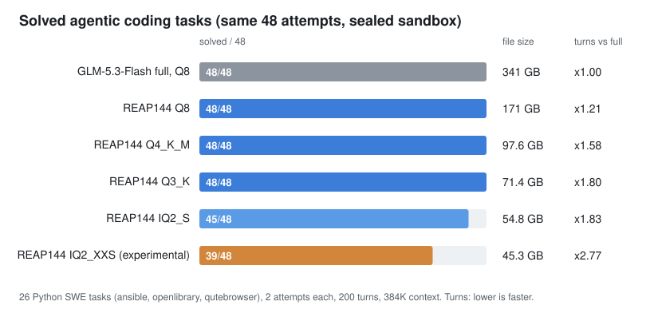

# GLM-5.3-Flash-REAP144-Coder

> **Known issue (15 Oct 2026):** this release was calibrated on Python agentic coding sessions only. Outside that
> domain it loses general reasoning: it can get simple arithmetic wrong (for example 17 x 23) and often loops on other
> programming languages and on general questions, at every quant including Q8. A new release, calibrated on a mix of
> agentic sessions, code in 21 languages and math, is being validated and will replace these files. Until then, use
> this model for Python agentic coding only.

A 321B MoE coding model cut in half for home PCs. We kept 144 of the 288 routed experts in every MoE layer of
[GLM-5.3-Flash](https://huggingface.co/zai-org/GLM-5.3-Flash), chosen on real agentic coding sessions, then quantized
it with an importance matrix built on the same sessions: **321B-A18B becomes 161B-A17B**.

- **Q4_K_M (98 GB) and Q3_K (71 GB) solve 48/48**, like the full 341 GB model, on real repository tasks in a sealed
  sandbox.
- **IQ2_S (55 GB) solves 45/48**; **IQ2_XXS (45 GB) fits a 24 GB GPU + 32 GB RAM PC** and is experimental (39/48).



Weights (GGUF): [lapadatbogdan/GLM-5.3-Flash-REAP144-Coder-GGUF](https://huggingface.co/lapadatbogdan/GLM-5.3-Flash-REAP144-Coder-GGUF)

This repository is the recipe: expert scoring, masks, pruning, quantization, the llama.cpp patches we needed, and
the evaluation harness, as we ran them.

## Results

30 SWE tasks from three Python repositories (ansible, openlibrary, qutebrowser), 2 attempts each, clean room (no git
history, no gold patch reachable), 200 turns, 384K context, success = the task's fail-to-pass tests pass.
Four tasks are left out: three that no model solves (one has a broken environment) and one whose tests sometimes
pass without a fix. All rows are counted on the **same 48 attempts** (26 tasks x 2, minus 4 attempts that hit our
12-hour wall-clock limit per attempt on at least one model; they are left out for every model), so the numbers
compare directly.

| Model | Size | Solved (same 48 attempts) | Turns vs full model |
|---|---|---|---|
| GLM-5.3-Flash, full (Q8) | 341 GB | 48/48 | x1.00 |
| **REAP144 Q8** | 171 GB | 48/48 | x1.21 |
| **REAP144 Q4_K_M** | 97.6 GB | 48/48 | x1.58 |
| **REAP144 Q3_K** | 71.4 GB | 48/48 | x1.80 |
| **REAP144 IQ2_S** (2.5 bit) | 54.8 GB | 45/48 | x1.83 |
| **REAP144 IQ2_XXS** (2 bit, experimental) | 45.3 GB | 39/48 | x2.77 |
| Public REAP 50% (multi-domain calibration, healed), Q8 | 175 GB | 44/46 * | x2.29 |
| Frequency mask, 144 experts, Q8 | 171 GB | 39/43 * | x2.21 |
| REAP, 120 experts, Q8 | 144 GB | 35/38 * | x2.32 |

\* not all attempts run; counted on the attempts finished.

"Turns vs full model" = total agent turns on attempts both models solved, divided by the full model's turns. It is
the cost you pay in time: a model that solves the task in twice the turns takes twice as long on your PC.
Differences of one attempt, or of x1.8 vs x1.9 turns, are within noise.
Numbers as of 13 Oct 2026.

What this says:
- **Which experts you keep matters more than how many.** At the same 144 experts, the mask scored on code sessions
  solves the same tasks as the full model with about 20% more turns; a frequency mask or a REAP mask
  calibrated on a multi-domain corpus needs about twice the turns and fails more.
- **2.5 bit and up is solid for agentic coding; 2 bit is experimental.** IQ2_XXS is the only version that fits a
  24 GB GPU + 32 GB RAM PC, and it solves 39 of 48 attempts. Its weak spot is how it fails: 200 turns and no
  edit at all. Half are loops (one command repeated up to 193 times), half are open-ended exploration that never
  commits to a fix. It also needs more turns (x2.8 overall). An anti-loop guard in the agent does not fix this (see What did not work); an
  improved 2 bit version trained on short successful sessions is in progress.
- **Short questions do not detect a broken agent.** A 2 bit variant of the public prune answered 4/4 short coding
  questions correctly and solved 0/4 agentic tasks.

## Perplexity

Perplexity on ~22K tokens of unseen code (11 chunks of 2048), llama.cpp `llama-perplexity`, same file for all:

| Model | PPL | vs full |
|---|---|---|
| GLM-5.3-Flash, full (Q8) | 1.681 | - |
| REAP144 Q8 | 2.053 | +22.1% |
| REAP144 Q4_K_M | 2.062 | +22.7% |
| REAP144 Q3_K | 2.091 | +24.4% |
| REAP144 IQ2_S | 2.174 | +29.3% |
| REAP144 IQ2_XXS | 2.303 | +37.0% |

We choose variants by results on agentic tasks; perplexity is shown for reference.

## Hardware

| File | Size | Fits (GPU VRAM + system RAM) |
|---|---|---|
| IQ2_XXS | 45.3 GB | 24 GB + 32 GB (measured) |
| IQ2_S | 54.8 GB | 32 + 32 at the limit; 24 + 48 or more |
| Q3_K | 71.4 GB | 24 + 64, 32 + 64 |
| Q4_K_M | 97.6 GB | 24 + 96, 32 + 96, 128 GB unified memory |

Measured: IQ2_XXS with [Maya](https://github.com/mw00/project-maya) on an RX 7900 XTX (24 GB) + 32 GB DDR4-2133,
i7-7700K, PCIe 3.0 (a 2017 PC): **~16 tokens/s generation, ~950 tokens/s prompt processing**. That is the floor:
a newer PC with DDR5 and PCIe 4.0 will be faster.

Measured by a community tester: RTX 4090 (24 GB) + 64 GB DDR5-4800, i9-14900K, PCIe 4.0, Windows 11, Maya v1.1.9
after `--calibrate`, context 32K:

| File | Generation | Prompt processing (2K / 8K tokens) |
|---|---|---|
| IQ2_XXS | **35.9 tokens/s** | 1441 / 2564 tokens/s |
| IQ2_S | **29.9 tokens/s** | 1092 / 2382 tokens/s |
| Q3_K | **20.4 tokens/s** | 792 / 2184 tokens/s |

Calibration added 16% (IQ2_XXS) to 50% (Q3_K) generation speed on that PC.

## Run

Download one variant into its own folder (split files load directly from the first part):

```bash
pip install -U huggingface_hub
hf download lapadatbogdan/GLM-5.3-Flash-REAP144-Coder-GGUF --include "*IQ2_XXS*" --local-dir glm53-iq2xxs
```

- **Maya** (made for GLM-5.3-Flash; keeps the most used experts on the GPU and the rest in RAM). This is how we
  measured the speed above, on AMD with ROCm:

  ```bash
  git clone https://github.com/mw00/project-maya && cd project-maya
  ./maya.sh --gguf-dir ../glm53-iq2xxs --no-vision --backend hip --gpu 0 --context 32768
  ```

  Leave out `--backend hip` on NVIDIA. `--no-vision` because this release is text only. The folder must be writable:
  Maya writes its index (~1 GB) next to the model files.
- **llama.cpp** (tested at `79e2e74`): `llama-server -m <first .gguf> --jinja -c 131072`, with expert tensors
  offloaded to CPU as needed (`--n-cpu-moe`).
- **2+ GPUs:** an optional MTP draft block (`GLM-5.3-Flash-REAP144-Coder-MTP.gguf`, 2.6 GB) lets Maya draft tokens
  ahead (`--gpus 0,1 --env STRATA_GLM_MTP_GGUF=<file>`). Its draft matches this model's next token ~70% of the time;
  the speedup is not measured by us yet. Details on the model card.

## Recipe

1. **Calibration sessions** (`scoring/build_calib.py`): agentic coding sessions written by the full model on tasks
   that are not in the evaluation set; 512 search windows + 64 held-out windows.
2. **Expert scores** (`rco/reap_score.py`): one forward pass of the full model over the sessions with its own
   routing. For each expert: `sum(g * ||f_e(x)||)` over the tokens routed to it, where `g` is the router weight and
   `f_e(x)` the expert output (REAP, Lasby et al. 2025, summed instead of averaged, so it counts both how often
   an expert is chosen and how much it contributes).
3. **Masks** (`masks/`): keep the top 144 per layer. Held-out KL to the full model:

   | Experts kept | Frequency | REAP mean | REAP sum |
   |---|---|---|---|
   | 144 | 0.94 | 0.85 | **0.73** |
   | 96 | 1.47 | 1.26 | **1.07** |

4. **Prune** (`build/build_pruned.py`, `build/stageC.sbatch`): drop experts and router rows, write a HF checkpoint,
   convert to GGUF.
5. **Quantize** (`build/*.sbatch`): llama.cpp imatrix on the same code sessions, then Q4_K_M / Q3_K / IQ2_S /
   IQ2_XXS. KLD to Q8 on code: 0.051 / 0.084 / 0.147 / 0.208.
6. **Evaluate** (`eval/`): see below.

## llama.cpp patches

`patches/` (llama.cpp `79e2e74`):
- `llama.cpp-imatrix-glm5_next.patch`: `llama-imatrix` segfaults on GLM-5.3-Flash (graph nodes without `src[0]`);
  fixed by checking the node type first. Needed to build the importance matrix, not to run the model.
- `llama.cpp-glm5_next-per-layer-experts.patch`: lets a pruned model keep a different number of experts per layer.
  Not needed for this release (144 in every layer).

All released GGUFs were run with llama.cpp `79e2e74` in our evaluation; IQ2_XXS was also measured with Maya.

## Evaluation harness

`eval/agent_py.py` is a minimal bash-tool agent (OpenAI-compatible API, llama.cpp server), `eval/run_eval_py.sh`
runs it under Singularity with a clean room per attempt.

**Anti-loop agent.** `eval/agent_py_v2.py` adds three guards, visible only to the model's own tool outputs: a notice
when a command's output was truncated, a blocker for a command repeated 3 times in a row or 5 times in the last 20
turns, and a warning for invalid `sed` line ranges. Select it with `AGENT=agent_py_v2.py` (default `agent_py.py`,
which produced every number in the results table; `AGENT_ANTILOOP=0` turns the guards off in v2):

```bash
AGENT=agent_py_v2.py K=1 CTXSLOT=393216 TASKLIST=tasks.txt EVAL_GGUF=GLM-5.3-Flash-REAP144-Coder-IQ2_XXS.gguf \
  GEN_OUT=out/antiloop bash eval/run_eval_py.sh
```

`eval/eval_tasks_py.txt` lists the 30 tasks (SWE-bench Pro style instances). The scripts are published as we ran
them, with our paths; expect to adapt them.

**Security notes.** The harness executes commands written by the model. Run it only inside disposable,
isolated containers on a machine with nothing you care about: the model's commands see the container's environment
(so do not put API keys there; with a local llama.cpp server none is needed), and a writable overlay is reused
between attempts of the same worker. The pass/fail check runs the task's tests and rejects edits to test files, but a
determined model could still change test configuration it does not detect; review successful patches if you build
on these numbers.

Things we learned the hard way, all visible in the scripts:
- Our first harness capped agents at 30 turns and 128K context; that cap hid most failures of the full model. Caps
  you set yourself look like model limits.
- New files must be added with `git add -N` or they are missing from the patch.

## What did not work

So you do not have to try it. Same tasks and harness as above unless noted; * = not all attempts run.

| Tried | Result | Why it failed |
|---|---|---|
| Keep 120 experts (same REAP-sum score) | 35/38 *, x2.32 turns; held-out KL 0.88 | The model starts "thinking" for tens of thousands of tokens without answering, and loops on commands |
| Keep 96 experts | held-out KL 1.07; ~90 turns per conversation, stopped | Too slow to be useful even when it solves the task |
| Frequency mask, 144 experts | 39/43 *, x2.21 turns; held-out KL 0.94 | Keeps the most used experts, not the ones that matter for code |
| Public REAP 50% (multi-domain), 144 experts | 44/46 *, x2.29 turns | Generic calibration; at 2 bit (IQ2_XXS) it answered 4/4 short questions and solved 0/4 tasks |
| 120 experts at 2-2.5 bit (IQ2_S, mixed quant) | 9/12 on a screen; the mixed quant looped in its reasoning | Pruning and low bits compound |
| RCO search over experts (`rco/`) | held-out KL 1.52 at 144 experts (frequency: 0.94) | Our search scored masks without re-routing tokens of removed experts, and 12,096 keep/drop decisions were too noisy; fixed later (`--reroute`) but not pursued once REAP-sum won |
| Healing: LoRA distillation from the full model (top-20 logits) | held-out KL 0.728 -> 0.686 at step 16, then 0.984 at step 32; no gain at 2 bit on tasks | Training router and norms diverged at once; LoRA-only diverged after ~16 steps |
| Anti-loop agent on IQ2_XXS (`eval/agent_py_v2.py`) | 27/37 vs 30/37 with the standard agent, same attempts, same turns | It recovers some looping attempts (4) and loses others (7): blocked, the model finds another loop or keeps exploring instead of editing. The 2 bit problem is behaviour, not a missing brake |
| GSQ instead of imatrix at ~3 bit | KLD 0.0711 vs 0.0702 (8 of 42 layers) | No gain at 3 bit. GSQ is a scalar method: the lowest llama.cpp scalar format (Q2_K, ~2.6 bits) is above the 2.06-bit size of IQ2_XXS, so it cannot target the 24 + 32 GB variant |

Limits of this study: one language (Python), three repositories, 2 attempts per task; differences of 1-3 attempts
are noise. Harness limits we hit and removed along the way: a 30-turn cap, a 128K context, and a rule that ended an
attempt after 3 replies without a command (now 10); affected attempts were rerun.

## Acknowledgements

- REAP (Lasby et al., 2025) for the expert-saliency score our mask builds on.
- This project was built with the help of Claude (Anthropic) as a coding and research assistant.
  The decisions are the author's.

## Credits and licenses

- Base model: GLM-5.3-Flash by Z.ai, MIT.
- REAP expert scoring: Lasby et al., 2025. Public REAP 50% comparison: `patrickbdevaney/GLM-5.3-Flash-REAP50-FP8-v2`.
- `rco/`: based on the RCO reference implementation by Helcig and Alistarh (Apache-2.0, see `rco/LICENSE` and
  `rco/CITATION.cff`), extended with the GLM-5.3-Flash model code and the REAP scorer.
- Runtime: llama.cpp (MIT), Maya (MIT).
- Everything else in this repository: MIT.

Contact: lapadat.bogdanv@gmail.com or [LinkedIn](https://www.linkedin.com/in/bogdan-lapadat-57baa08/)
